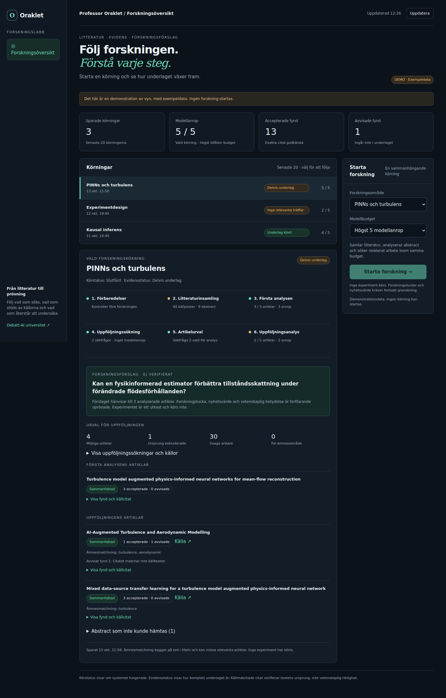

# Professor Oraklet research dashboard

The Cloudflare Worker serves a Swedish operator dashboard at `/research` and a clearly labelled, read-only example at `/research/demo`. It adds a visual control surface to the existing research pipeline: choose an area and a budget, start once, then inspect the saved stages, searches, article selection, accepted findings, rejection reasons and unverified candidate. No model inference runs inside the dashboard Worker, and no experiments are enabled.

The selected run shows its complete GitHub URL with a copy button, even when a saved run ID is available but GitHub status lookup fails. Clipboard failures offer manual selection without claiming a successful copy. A separate live run message follows the selected run from queued to its technical final outcome and retains the distinct evidence status.

The timeline shows six steps: preflight, collection, initial evidence, follow-up searches, selection and follow-up evidence. Pipeline checkpoints contain small display summaries and the references to the complete reports. Full abstracts and raw model answers are not copied into them. Snapshots are saved at stage boundaries, rather than streamed token-by-token. The page refreshes every 20 seconds while visible.

Execution status comes from GitHub separately from the last saved scientific status. A successful workflow does not establish a research gap or novelty. A cancelled or failed workflow may have only an intermediate checkpoint and an incomplete model-call count. Checkpoints from earlier workflow attempts are explicitly distinguished from a newer rerun. Failed or uncertain workflow dispatches are visible instead of silently retried.

## One-time setup after merge

1. Run [20261013000000_research_dashboard.sql](../supabase/migrations/20261013000000_research_dashboard.sql) in the orchestrator project's Supabase SQL Editor. This creates one private table and a checkpoint RPC. RLS is enabled; anonymous and authenticated database roles receive no access. Only the backend service role may read/write it.
2. In this repository's **Settings → Secrets and variables → Actions → Variables**, set `RESEARCH_DASHBOARD_ENABLED` to `true`. The existing Actions `SUPABASE_URL` variable and `SUPABASE_SECRET_KEY` secret continue to be used. Without this opt-in, ordinary manual pipeline runs keep working without the new table. Dashboard-requested runs require persistence enabled and fail before inference if it is missing.
3. Create an expiring fine-grained GitHub personal access token restricted to **cryptomanxxx/debatt-ai-orchestrator** with repository **Actions: Read and write** (and GitHub's mandatory Metadata: Read). Store it as a Cloudflare **runtime secret** named `RESEARCH_GITHUB_TOKEN`. It is used only for the fixed research workflow on `main`; no code, PR or merge write API is exposed. The token is never sent to the browser. GitHub App installation tokens are also accepted, but this version does not mint or renew them; use a token that remains valid for the intended session.
4. In the existing orchestrator Worker, add runtime secret `SUPABASE_SECRET_KEY` using the same orchestrator-database key already used by Actions, and confirm runtime variable `SUPABASE_URL` matches that project (both checked-in Worker configurations declare the orchestrator project's URL). Add a **separate** random runtime secret `RESEARCH_DASHBOARD_KEY` of at least 24 characters. This dashboard-only key does not authorize `/v1/query`. Configure the GitHub token only after step 2 is complete. Do not put these secrets in Git or in Cloudflare build variables.
5. Wait for the existing Git-connected Worker deployment from `main`, then open `https://debatt-ai-orchestrator.xx8031126.workers.dev/research`. Enter the dashboard key and choose **Starta forskning**. The key stays only in the current page's memory, and is cleared on logout/reload. GitHub/Supabase credentials remain on the server.

For later operation, use the dashboard. GitHub Actions remains the executor, so the existing workflow concurrency, runner time limit, model quotas and artifact retention remain in force. No schedule is added. Earlier pipeline artifacts are not automatically backfilled into this new table; existing analysis/follow-up records remain intact in their original tables. History displays the latest 20 recorded pipeline starts/runs.

`/research/demo` works immediately after deploying the code, without database configuration or API credentials, and cannot start a run. Its data are fabricated examples clearly marked as such.

## Request identity and failures

The browser assigns a UUID before starting. The Worker first claims that UUID in Supabase, then dispatches the fixed workflow. A duplicate UUID with the same parameters returns the existing request and never dispatches again. A different area/budget for that UUID is rejected. The browser retains only pending request parameters (no credential) in session storage for recovery after a lost response. If storage is unavailable, recovery lasts for the current page session only.

A timeout is not proof that GitHub rejected a start. Uncertain starts are not retried automatically; wait for the matching workflow or inspect GitHub. Dispatch responses can supply the run ID; for older no-content responses the read path looks for the UUID in the workflow's fixed run name among the latest 30 manual main runs. A request that never starts keeps its queued/uncertain marker. There is no automatic cancellation, replay or code modification. A genuinely new UUID is a new authorized run and can spend a new budget.

Checkpoints use the workflow run ID, rerun attempt and a monotonic sequence. Delayed snapshots cannot replace newer snapshots, and a request cannot change its area, budget or bound workflow ID. If checkpoint storage fails, the pipeline stops; local artifact checkpoints are written before database writes and remain available for troubleshooting. At an interrupted inference stage the actual call count may be unknown.

## API and security

- `GET /research`, `/research/demo`, `/research/app.js`, `/research/demo-data`: public static shell or labelled example data.
- `GET /v1/research/runs`: dashboard-key protected, latest 20 summaries and start availability.
- `GET /v1/research/runs/{uuid}`: dashboard-key protected, saved snapshot and GitHub execution status where available.
- `POST /v1/research/runs`: dashboard-key protected JSON containing exactly `id`, `area`, `model_budget` (5 or 10).

Research routes use their own credentials and do not depend on model configuration for displaying the shell. All responses use `no-store`. Writes with a different Origin are refused; no cross-origin browser access is enabled. Static scripts come from the same origin, external frames are blocked, and source/model text is rendered with text nodes rather than inserted as HTML. Source links allow only known HTTPS source hosts. Error responses do not include raw upstream bodies or credentials. There is no public report API.

## Validation

`npm test`, `npm run check:workers`, `npm run test:workers` cover the shared contracts, checkpoint identities and failure accounting, bounded storage, real workerd authentication, exact fixed dispatch, idempotency and uncertain outcomes. The PostgreSQL CI job applies the migration and checks grants, domain/budget constraints, workflow identity and stale checkpoint/rerun handling using [research-dashboard.sql](../tests-literature-sql/research-dashboard.sql).

Reference: [GitHub workflow dispatch documentation](https://docs.github.com/en/rest/actions/workflows#create-a-workflow-dispatch-event). GitHub API version `2026-03-10` returns a workflow-run receipt; this client also handles the older 204 response without inventing a run identity.
